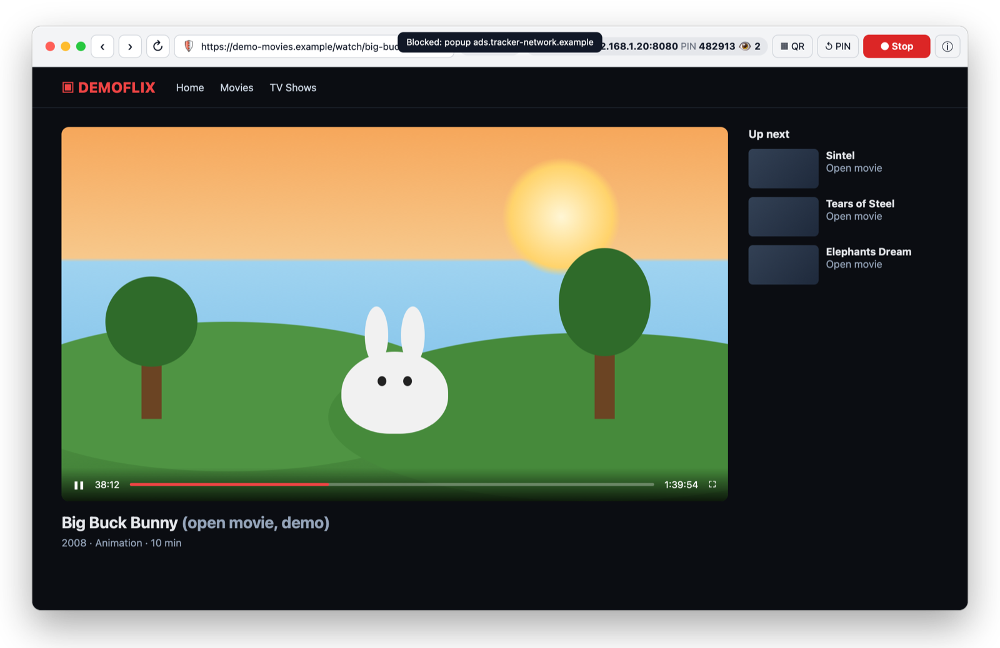
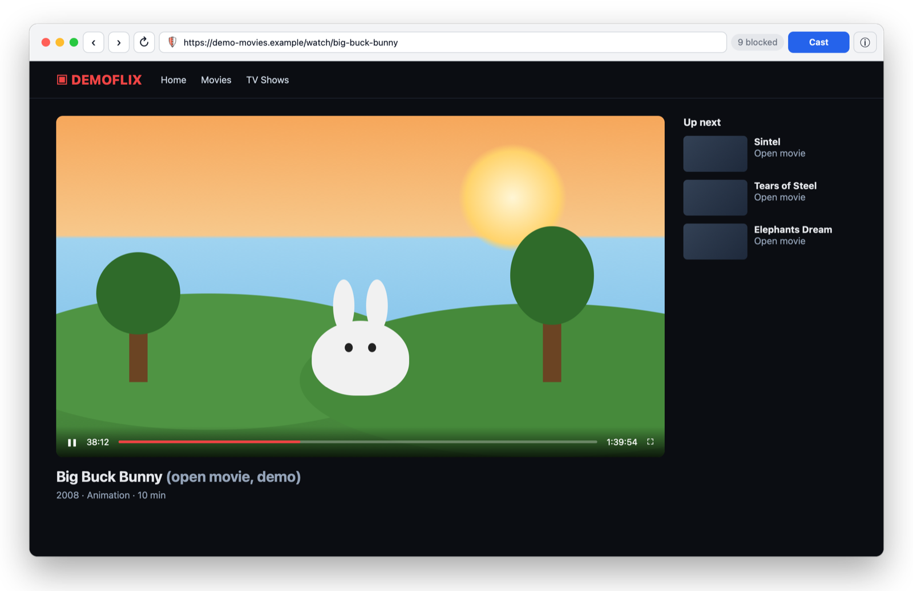
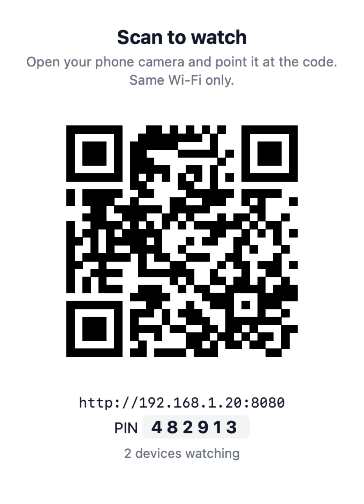
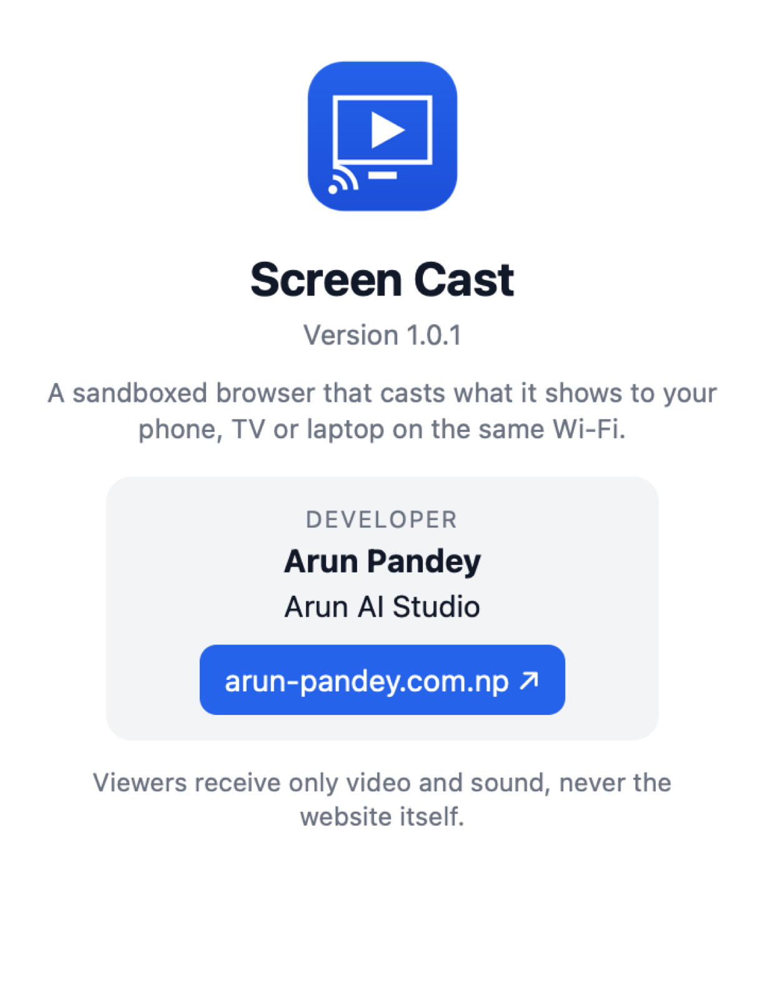
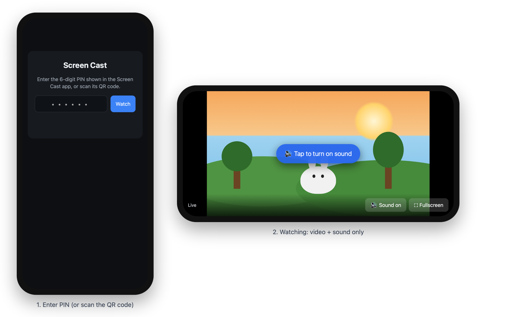
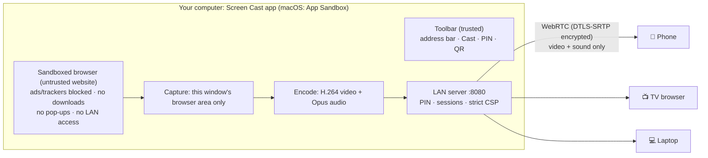
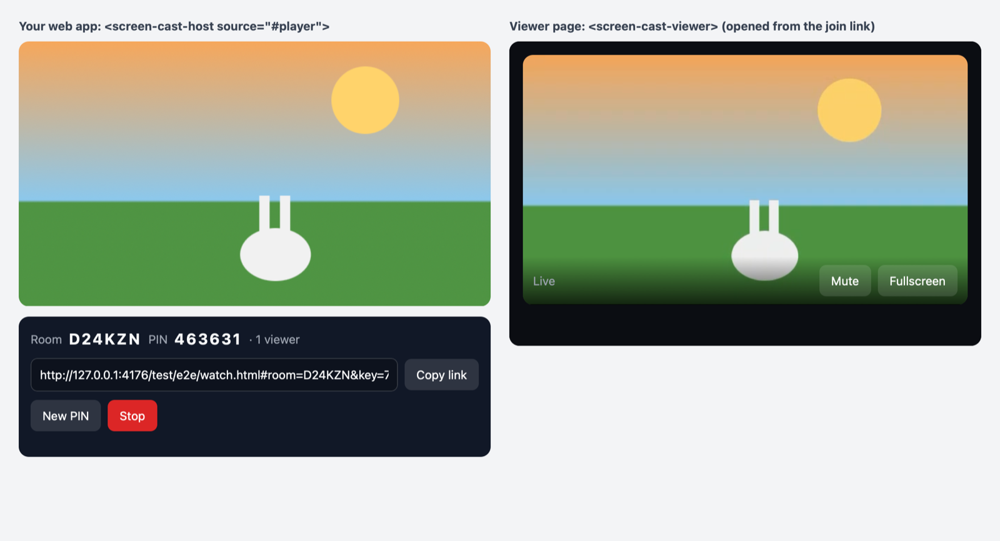

<p align="center">
  
</p>

<h1 align="center">Screen Cast</h1>

<p align="center">
  <b>A sandboxed browser that casts what it shows to your phone, TV or laptop over Wi-Fi, with nothing from the website ever reaching them.</b><br>
  macOS · Windows · Linux · Built with Rust + Tauri
</p>

<p align="center">
  <a href="https://github.com/00Arun/screen-cast/actions/workflows/ci.yml"></a>
  <a href="https://www.npmjs.com/package/secure-screen-cast"></a>
  <a href="../../releases/latest"></a>
</p>

<p align="center">
  <a href="../../releases/latest"><b>⬇ Download the latest release</b></a> ·
  <a href="#install">Install</a> ·
  <a href="#how-to-use">How to use</a> ·
  <a href="#security">Security</a> ·
  <a href="#build-from-source">Build</a>
</p>



---

## What it is

Many free movie sites are full of pop-ups, redirects, fake "your computer is infected"
alerts and forced downloads. Casting such a site from a normal browser exposes both your
computer and every device you cast to.

**Screen Cast** solves this with two ideas:

1. **The website runs in a locked-down browser.** Ads, trackers and malware domains are
   blocked. Downloads, pop-ups, links that open other apps, and access to your files, camera,
   microphone and local network are all switched off. On macOS the whole app also runs inside
   Apple's **App Sandbox**.
2. **Viewers only get pixels and sound.** The app records its *own* browser area and streams
   it as encrypted video (WebRTC). Phones and TVs never load the website, so there is nothing
   on their side that an ad or script could run.

Other devices open a link (or scan a QR code), and the movie plays. No app to install on the
viewing device: any modern browser works (iPhone, Android, smart TV browser, another laptop).

## Features

| | |
|---|---|
| 🛡 **Sandboxed browsing** | Private mode, ad/tracker/malware blocking (EasyList, EasyPrivacy, uBlock Origin *badware*), no downloads, no pop-ups, no scam dialogs |
| 📡 **Cast to any browser** | Phones, tablets, TVs and laptops on the same Wi-Fi, with several viewers at once |
| 🔑 **PIN + QR code** | 6-digit PIN with brute-force lock-out. Scan the QR code to start watching instantly |
| 🎬 **True fullscreen** | The player's fullscreen button fills the screen with only the movie (no site header or app toolbar), on the computer and on viewers |
| 🔊 **Sound included** | Only Screen Cast's own sound is cast. Calls, music and notifications from other apps are not |
| ⚡ **Smooth playback** | Hardware H.264 on macOS, instant recovery from Wi-Fi packet loss, playout buffer on viewers |
| 🖥 **Cross-platform** | macOS (`.dmg`), Windows (`.exe` / `.msi`), Linux (`.deb` / `.AppImage`) |

## Screenshots

<table>
<tr>
<td width="50%"><br><sub><b>Browsing.</b> The 🛡 shows the sandbox is active, and the counter shows what was blocked on this page.</sub></td>
<td width="50%"><br><sub><b>Casting.</b> The toolbar shows the address, the PIN and how many devices are watching. A blocked pop-up is reported.</sub></td>
</tr>
<tr>
<td><br><sub><b>Fullscreen.</b> Only the movie is shown. The site header, menus and app toolbar are hidden. Press <kbd>Esc</kbd> to leave.</sub></td>
<td align="center">&nbsp;&nbsp;<br><sub><b>Scan to watch</b> (opens when casting starts and is never part of the cast) and <b>About</b>.</sub></td>
</tr>
<tr>
<td colspan="2" align="center"><br><sub><b>On the viewing device.</b> Enter the PIN or scan the QR code, then watch. Tap <i>Turn on sound</i> if the browser starts muted.</sub></td>
</tr>
</table>

<sub>Screenshots show the real app UI with demo data (a demo movie page, address <code>192.168.1.20</code>, PIN <code>482913</code>).</sub>

## How it works



1. You browse in the sandboxed browser. A trusted toolbar controls it, and the website cannot
   talk to the toolbar or the app.
2. When you press **Cast**, the app captures **only its own window**, cropped to the browser
   area. Other apps, notifications and your desktop are never captured.
3. Video is encoded as H.264 (hardware VideoToolbox on macOS, OpenH264 on Windows/Linux) and
   audio as Opus.
4. A small built-in web server on port `8080` serves a tiny viewer page. After the PIN is
   accepted, each viewer gets its own encrypted WebRTC connection that carries only media.

## Download

Go to **[Releases](../../releases/latest)** and download the file for your system:

| System | File | Requirements |
|---|---|---|
| macOS (Apple Silicon & Intel) | `ScreenCast-<version>-macos-universal.dmg` | macOS 14 Sonoma or newer |
| Windows | `ScreenCast-<version>-windows-x64-setup.exe` or `.msi` | Windows 10 (2004+) or 11 |
| Linux | `ScreenCast-<version>-linux-amd64.deb` or `-linux-x86_64.AppImage` | X11 or Wayland (via XWayland), PulseAudio or PipeWire |

## Install

### macOS
1. Open the `.dmg` and drag **Screen Cast** onto **Applications**.
2. The app is not notarized by Apple, so the first launch is blocked. Go to **System Settings →
   Privacy & Security**, scroll down, and click **Open Anyway**. (Or run
   `xattr -dr com.apple.quarantine "/Applications/Screen Cast.app"` in Terminal.)
3. When you first press **Cast**, allow **Screen & System Audio Recording**, then quit and
   reopen the app. The permission is kept across updates.
4. Allow **Local Network** access when asked.

### Windows
1. Run the `-setup.exe` (or the `.msi`). If SmartScreen warns about an unknown publisher,
   choose **More info → Run anyway**.
2. When Windows Firewall asks, allow Screen Cast on **Private networks** so other devices can
   connect.

### Linux
```bash
sudo apt install ./ScreenCast-<version>-linux-amd64.deb     # Debian / Ubuntu
# or
chmod +x ScreenCast-<version>-linux-x86_64.AppImage && ./ScreenCast-<version>-linux-x86_64.AppImage
```
`bubblewrap` (a `.deb` dependency) runs websites in WebKit's extra sandbox. `pulseaudio-utils` provides per-app audio capture.

## Use it in your own web app (npm)

The casting part is also published as a **web library** for developers. Add secure screen,
tab, `<video>` or `<canvas>` casting with PIN/QR viewing to any website:

```bash
npm install secure-screen-cast
```

```html
<script type="module">import 'secure-screen-cast/elements';</script>
<screen-cast-host server="/cast" viewer-url="/watch"></screen-cast-host>   <!-- casting page -->
<screen-cast-viewer server="/cast"></screen-cast-viewer>                   <!-- viewer page -->
```

```js
import { createCastServer } from 'secure-screen-cast/server';    // Node signaling server
app.use(createCastServer({ path: '/cast' }).middleware);
```

Zero dependencies, TypeScript types, web components plus a JS API (`CastHost`, `CastViewer`).
See **[npm/README.md](npm/README.md)** for the full guide.



## How to use

1. **Browse.** Type a site in the address bar and start the movie.
2. **Cast.** Press **Cast**. A **Scan to watch** window opens with a QR code. The toolbar shows
   the address (for example `http://192.168.1.20:8080`), the **PIN** and the number of viewers.
3. **Watch on another device** on the same Wi-Fi:
   - **Scan the QR code** with the phone camera and tap the link. Playback starts immediately.
   - Or open the address in any browser and type the PIN.
   - Tap **🔊 Turn on sound** if the browser started muted, and **⛶ Fullscreen** for full screen.
4. **Fullscreen.** Press the player's own fullscreen button. The computer goes fullscreen with
   only the movie, and viewers see only the movie. Press <kbd>Esc</kbd> to leave.
5. **Control access.** **↺ PIN** creates a new PIN, disconnects everyone and invalidates the
   old QR code. **● Stop** ends the cast.

| Toolbar | |
|---|---|
| ‹ › ↻ | Back, forward, reload |
| 🛡 + address bar | Enter a site or a search (DuckDuckGo) |
| *N blocked* | Ads, pop-ups, redirects and downloads blocked on this page |
| **Cast** / **● Stop** | Start or stop casting |
| ▦ QR | Show the *Scan to watch* window |
| ↺ PIN | New PIN, which disconnects all viewers |
| ⓘ | About Screen Cast (version and developer) |

## Security

### What protects the computer running Screen Cast

| Protection | Details |
|---|---|
| **App Sandbox** (macOS) | The app has no access to your files, Downloads, Desktop, camera, microphone or contacts. Its only entitlements are network client and server. |
| **Engine sandbox** | Websites run in the engine's own sandboxed process: WebKit on macOS, WebView2 on Windows, WebKitGTK with bubblewrap on Linux. |
| **Private mode** | Cookies, cache and storage are discarded when the app quits. |
| **No downloads** | Every download is cancelled. `<a download>` and blob downloads are blocked too. |
| **No pop-ups** | `window.open`, `target=_blank` pop-ups and pop-unders are denied. A same-site link opens in place. |
| **No app-launching links** | Only `http`, `https`, `blob` and `about:blank` can load. `file:`, `data:`, `mailto:`, `itms-apps:`, `facetime:` and custom app schemes are blocked. |
| **Ad, tracker and malware blocking** | EasyList, EasyPrivacy and uBlock Origin *badware* are enforced twice: by Brave's adblock engine on every page and iframe navigation, and natively inside the engine for every script, image, iframe and request (WebKit content rules, or WebView2 request filtering). |
| **No local-network access** | All website traffic goes through a built-in filtering proxy that resolves DNS itself and refuses any destination whose **resolved** address is local: loopback, `10.x`, `172.16–31.x`, `192.168.x`, link-local, CGNAT `100.64/10`, IPv6 local and similar. It then connects to exactly the address it checked. This defeats tricks like `127.0.0.1.nip.io`, `localhost.` and DNS rebinding, and protects your router, NAS, local dev servers and the cast server itself. WebRTC is disabled for websites so it can't bypass the proxy. |
| **Scam and abuse APIs removed** | Before any page script runs, Screen Cast disables `alert`/`confirm`/`prompt` (fake virus warnings), leave-page traps, clipboard hijacking (including `copy`-event tampering), camera/microphone/location/screen requests, notifications, service workers, file pickers and protocol handlers. They are locked on the prototypes too, so they can't be reached another way. |
| **Trusted UI is isolated** | Only the local toolbar, QR and About webviews can call app commands, each with its own explicit allow-list. The website has no IPC access at all. Back/forward use the engine's native API, so a page can't hijack them. |
| **Fullscreen can't be abused** | Fullscreen needs a real click or tap, only iframes marked `allowfullscreen` qualify, and switching is rate-limited. The page can't fake its fullscreen state. After you leave with <kbd>Esc</kbd> or the window controls, the page can't pull you back in. |
| **No external apps** | On Windows, iframes get the same scheme policy as the page, and every attempt to launch another app (`ms-msdt:`, `search-ms:`, `mailto:`…) is cancelled. |

### What protects viewers

- They receive **only an encrypted WebRTC media stream**: no HTML, JavaScript, cookies, ads,
  redirects or downloads from the website.
- The viewer page is a small static page with a strict Content-Security-Policy (only its own
  script, no frames, no third-party content) plus `X-Frame-Options`, `nosniff`,
  `Referrer-Policy` and `Permissions-Policy` headers.

### What protects the cast itself

- **A fresh PIN for every cast**, and joining is only possible while casting. After 5 wrong
  tries a device is locked out for 5 minutes. After 20 wrong tries from anywhere on the
  network, the PIN changes automatically, so spreading guesses over many addresses doesn't
  help. PINs and tokens are compared in constant time.
- **Sessions** use random 256-bit tokens in `HttpOnly`, `SameSite=Strict` cookies. They only
  work from the device's own IP address, and they end when the cast stops.
- **LAN only.** Non-private addresses are refused when the connection is accepted. There is
  also a connection cap and a header-read timeout against slow-loris attacks.
- **Host header allow-list** blocks DNS-rebinding attacks, and the **Origin check** on every
  POST blocks cross-site requests from websites.
- **Viewer cap**, enforced atomically, plus request size limits. Signalling messages are
  strictly validated. Viewers still connecting when the PIN changes are dropped.
- The **QR code** carries a long random secret, not the PIN, in the URL `#fragment`, which
  browsers never send over the network. The viewer page removes it from the address bar
  straight away, and it stops working when the PIN changes or a new cast starts.
- While leaving fullscreen, the toolbar (which shows the PIN) appears only after the stream's
  crop is updated, so the PIN never shows up on viewers' screens.

### Limits

- No browser can promise complete protection against unknown engine exploits. Keep your OS
  updated, because engine security fixes ship with OS updates (WebKit on macOS) or
  automatically (WebView2 on Windows).
- The viewer page and PIN exchange use plain `http` on your LAN, while media is always
  encrypted (DTLS-SRTP). Someone who can intercept traffic on the same network (for example
  open café Wi-Fi with an attacker doing ARP spoofing) could see the PIN or tamper with the
  connection. Use it on networks you trust, like your home Wi-Fi.
- On Windows and Linux there is no whole-app OS sandbox, only the engine's own.
- macOS builds without an Apple Developer ID are ad-hoc signed. The Screen Recording
  permission is tied to the bundle id so it survives updates, which means another local
  program signed with the same id could match it. Build with
  `SIGN_IDENTITY="Developer ID Application: …" scripts/build-dmg.sh` to tie it to your
  certificate.
- macOS casts all sound except that of other *apps*. Sounds from command-line tools or system
  services may be included.

## Platform details

| | macOS 14+ | Windows 10 (2004+) / 11 | Linux |
|---|---|---|---|
| Browser engine | WebKit | WebView2 (Chromium) | WebKitGTK 4.1 |
| Own-window capture | ScreenCaptureKit | Windows.Graphics.Capture | X11 Composite (Wayland via XWayland) |
| Video encoder | VideoToolbox (hardware, up to 1080p) | OpenH264 (software, up to 720p) | OpenH264 (software, up to 720p) |
| Audio | Browser audio only (other apps excluded) | This app's process tree only (WASAPI process loopback, Windows 10 2004+) | This app's playback streams only (`parec --monitor-stream`, PulseAudio/PipeWire-Pulse) |
| Native ad blocking | WebKit content rules | WebView2 request filter | WebKitGTK content filters |
| Whole-app sandbox | ✅ App Sandbox | ❌ | ❌ (engine bubblewrap sandbox) |
| Installer | `.dmg` | `.exe` (NSIS), `.msi` | `.deb`, `.AppImage` |

## Build from source

Every platform needs **Rust** (stable) and **CMake**. Each installer must be built on its own
operating system.

**Every build gets a new version automatically.** The version lives in [`VERSION`](VERSION),
and each build script raises the patch number (1.0.1 → 1.0.2) and writes it into
`Cargo.toml`, `tauri.conf.json` and the macOS `Info.plist`. Use `BUMP=minor` or `BUMP=major`
to raise it more, or `NO_BUMP=1` to keep it. You can also run `scripts/bump-version.sh`
directly.

```bash
# macOS (needs Xcode Command Line Tools): dist/ScreenCast-<version>.dmg
scripts/build-dmg.sh                 # Apple Silicon
UNIVERSAL=1 scripts/build-dmg.sh     # Apple Silicon + Intel

# Linux (installs build dependencies with apt or dnf): src-tauri/target/release/bundle/{deb,appimage}/
scripts/build-linux.sh
```

```powershell
# Windows (needs Visual Studio 2022 Build Tools "Desktop development with C++", Rust and CMake;
# see the top of the script): src-tauri\target\release\bundle\{nsis,msi}\
powershell -ExecutionPolicy Bypass -File scripts\build-windows.ps1
```

### Releases and npm (automatic)

Pushing to `main` runs these GitHub Actions workflows:

| Workflow | What it does |
|---|---|
| [`ci.yml`](.github/workflows/ci.yml) | On every push and pull request: Rust tests on macOS, Windows and Linux, an end-to-end media self-test on macOS, and build, tests, audit and a dry-run pack of the npm library. |
| [`release.yml`](.github/workflows/release.yml) | When `VERSION` has no `v<version>` tag yet: builds the macOS universal `.dmg`, Windows `.exe`/`.msi` and Linux `.deb`/`.AppImage`, then creates the tag and a GitHub Release with `SHA256SUMS.txt` and the [CHANGELOG](CHANGELOG.md) entry as notes. |
| [`npm-publish.yml`](.github/workflows/npm-publish.yml) | When `npm/` changes and its version isn't on npm yet: builds, tests and publishes the `secure-screen-cast` web library with provenance through **npm Trusted Publishing** (no token). |

To release, bump the version (`scripts/bump-version.sh`, or any local build, which also updates
`npm/package.json`), add a `## [x.y.z]` section to `CHANGELOG.md`, commit and push.

One-time npm setup (only before the very first npm release):
1. Publish the package once by hand: `npm login`, then `cd npm && npm publish --access public`.
2. On npmjs.com, open **secure-screen-cast → Settings → Trusted Publisher → GitHub Actions** and enter
   owner `00Arun`, repository `secure-screen-cast`, workflow `npm-publish.yml`.

`scripts/publish-release.sh` can still upload a locally built `.dmg` by hand.

### Tests

```bash
cd src-tauri
cargo test                                            # ad blocking, URL policy, QR, encoders
SC_BIND_IP=127.0.0.1 cargo run -- --selftest out.h264 # macOS: encoder → WebRTC → viewer end-to-end
```

## Troubleshooting

| Problem | Fix |
|---|---|
| macOS keeps asking for Screen Recording | Turn on **Screen Cast** in *System Settings → Privacy & Security → Screen & System Audio Recording*, then quit and reopen the app. Remove duplicate entries with **–** first. |
| Phone can't open the address | Both devices must be on the same Wi-Fi (no "guest" network or AP isolation). Allow Local Network (macOS) or the firewall prompt (Windows). |
| "Wrong or expired PIN" after scanning | The PIN was changed with ↺ PIN. Scan the new QR code. |
| No sound on the phone | Tap **🔊 Turn on sound** (browsers often start muted). Check the movie isn't muted on the computer. |
| "Too many wrong tries" | Wait 5 minutes, or scan the QR code once the lock-out ends. |
| Linux: casting doesn't start | Screen Cast needs X11 or XWayland. It sets `GDK_BACKEND=x11` automatically, so check that XWayland is installed. |
| Linux: no sound | Install `pulseaudio-utils` (provides `pactl` and `parec`; it works with PipeWire too). |
| Windows: no sound | Per-app audio capture needs Windows 10 version 2004 or newer. |
| Video is choppy | Move closer to the router or use 5 GHz Wi-Fi. Fewer simultaneous viewers also helps. |

## Project layout

| Path | What |
|---|---|
| `src-tauri/src/main.rs` | Window, toolbar and sandboxed browser webviews, navigation/pop-up/download policy, commands, fullscreen sync, About |
| `src-tauri/src/harden.js` | Script injected into every frame before page scripts (API lockdown, in-page fullscreen) |
| `src-tauri/src/adblock.rs`, `contentrules/` | Filter engine + per-platform native blocking |
| `src-tauri/src/capture/` | Own-window capture: `macos.rs`, `windows.rs`, `linux.rs`, shared OpenH264 path `soft.rs` |
| `src-tauri/src/encoder.rs`, `audio.rs` | VideoToolbox H.264 (macOS), Opus + resampling (all) |
| `src-tauri/src/hub.rs` | WebRTC fan-out to viewers, key-frame on picture loss |
| `src-tauri/src/server.rs` | LAN web server (PIN, sessions, security headers, connection limits) |
| `src-tauri/src/netguard.rs` | Filtering proxy: blocks website traffic to local/LAN addresses after DNS resolution |
| `src-tauri/capabilities/` | Allow-lists of app commands per trusted window |
| `src-tauri/filters/` | Bundled filter lists |
| `ui/` | Toolbar, *Scan to watch* and About windows |
| `web/` | Viewer page served to other devices |
| `scripts/` | Build, version-bump and release scripts |
| `npm/` | `secure-screen-cast` web library: host/viewer API, web components, Node signaling server |
| `.github/` | CI, release and npm publish pipelines, Dependabot |
| `docs/screenshots/` | Images used in this README |

## About

**Screen Cast** · developed by **Arun Pandey**, **Arun AI Studio**
🌐 [arun-pandey.com.np](https://arun-pandey.com.np/)

The current version is shown in the app under **ⓘ → About**, and in the [`VERSION`](VERSION) file.

<sub>Bundled filter lists: EasyList and EasyPrivacy (GPLv3 / CC BY-SA), uBlock Origin badware list (GPLv3). Ad blocking engine: Brave adblock-rust (MPL-2.0). OpenH264 by Cisco (BSD).</sub>
