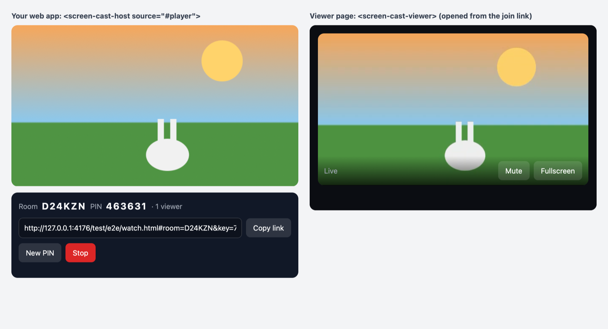

# screen-cast

**Add secure screen casting to any web app.** Share a screen, a browser tab, a `<video>`, a
`<canvas>` or any `MediaStream` from one browser, and let people watch it on their phone, TV
or laptop with a **room code + PIN** or a **one-tap join link**.

- 📡 **WebRTC**: video and sound go straight between browsers, encrypted (DTLS-SRTP). Your
  server only introduces them.
- 🛡 **Media-only viewers**: viewers receive pixels and sound, never your page's code.
- 🔑 **PIN + link**, brute-force lock-out, PIN rotation, viewer limits.
- 🧩 **Drop-in web components** (`<screen-cast-host>`, `<screen-cast-viewer>`) or a small
  JavaScript API. Works with any framework: React, Angular, Vue, Svelte or plain HTML.
- 🪶 **Zero dependencies**, ~19 kB, TypeScript types included, plus a tiny Node signaling
  server.



```bash
npm install screen-cast
```

## Quick start (3 steps)

**1. Server:** add the signaling endpoints to your Node server.

```js
// Express
import express from 'express';
import { createCastServer } from 'screen-cast/server';

const app = express();
const cast = createCastServer({ path: '/cast' });
app.use(cast.middleware);          // register BEFORE express.json() / body parsers; it only handles /cast/*
app.listen(3000);
```

**2. Casting page:** drop in the host component.

```html
<script type="module">import 'screen-cast/elements';</script>

<!-- casts the screen or a tab (the browser asks which one) -->
<screen-cast-host server="/cast" viewer-url="/watch"></screen-cast-host>

<!-- or cast a <video> / <canvas> on your page -->
<video id="player" src="/movie.mp4" controls></video>
<screen-cast-host server="/cast" viewer-url="/watch" source="#player"></screen-cast-host>
```

**3. Viewer page** (`/watch`):

```html
<script type="module">import 'screen-cast/elements';</script>
<screen-cast-viewer server="/cast"></screen-cast-viewer>
```

Pressing **Start casting** shows a room code, a PIN and a link. Viewers either open the link
(it joins immediately, which makes it ideal for a QR code) or type the room code and PIN on your
viewer page.

> With a bundler (Vite, webpack, Angular CLI, Next.js…) just `import 'screen-cast/elements'`
> once in your app. Without a bundler, serve `node_modules/screen-cast/dist/` and import
> `/…/dist/elements.js`.

## JavaScript API

Use the API when you want your own UI.

```js
import { CastHost, CastViewer } from 'screen-cast';

// ---- casting side ----
const host = new CastHost({ server: '/cast' });
host.on('viewers', (n) => console.log(`${n} watching`));
host.on('ended', () => console.log('cast ended'));

const session = await host.start({ source: 'screen' });   // or a <video>, <canvas>, MediaStream
showToUser(session.room, session.pin);
renderQrCode(session.joinUrl('https://example.com/watch')); // any QR library

await host.newPin();   // new PIN + link, disconnects everyone
await host.stop();

// ---- viewing side ----
const viewer = new CastViewer({ server: '/cast', video: document.querySelector('video') });
viewer.on('status', (s) => console.log(s));   // joining | waiting | connecting | live | reconnecting | ended | kicked

if (!(await viewer.joinFromUrl())) {          // joined from a #room=…&key=… link?
  await viewer.join({ room: 'D24KZN', pin: '463631' });
}
```

### React example

```jsx
import { useEffect, useRef } from 'react';
import { CastViewer } from 'screen-cast';

export function Watch() {
  const video = useRef(null);
  useEffect(() => {
    const viewer = new CastViewer({ server: '/cast', video: video.current });
    viewer.joinFromUrl();
    return () => viewer.leave();
  }, []);
  return <video ref={video} playsInline autoPlay muted controls />;
}
```

(Angular, Vue and others work the same way: create the object when the component mounts and
call `leave()` / `stop()` when it is destroyed. The web components work in every framework.)

## Server options

```js
import { createCastServer } from 'screen-cast/server';

const cast = createCastServer({
  path: '/cast',                         // URL prefix (default '/cast')
  maxRooms: 100,                         // simultaneous casts
  maxViewers: 12,                        // viewers per cast
  allowedOrigins: ['https://app.example.com'], // extra origins allowed to call the API (CORS)
  trustProxy: false,                     // true behind a reverse proxy that sets X-Forwarded-For
  authorizeHost: (req) => isLoggedIn(req), // who may START a cast (default: anyone, rate-limited)
  roomTtlMs: 6 * 60 * 60 * 1000,         // maximum cast length
});
```

| Use it with | |
|---|---|
| Express / Connect | `app.use(cast.middleware)` |
| Plain `node:http` | `http.createServer(async (req, res) => { if (!(await cast.handle(req, res))) yourHandler(req, res); })` |
| Standalone | `await cast.listen(8080)`. Serve your pages elsewhere and pass that origin in `allowedOrigins`. |
| Fastify / Koa / NestJS | Call `cast.handle(req.raw, res.raw)` (or the framework's raw Node objects). |

## Web component attributes

| `<screen-cast-host>` | |
|---|---|
| `server` | Signaling URL, default `/cast` |
| `viewer-url` | Your viewer page. Join links point here. Defaults to the current page. |
| `source` | `screen` (default) or a CSS selector of a `<video>` / `<canvas>` |
| `audio` | `false` to cast without sound |
| `ice-servers` | JSON array of STUN/TURN servers |
| Events | `cast-start` (`detail: { room, pin, joinUrl }`), `cast-viewers`, `cast-stop` |

| `<screen-cast-viewer>` | |
|---|---|
| `server`, `ice-servers` | As above |
| Events | `cast-status` (`detail: { status }`) |

**Theming:** CSS custom properties `--sc-accent`, `--sc-bg`, `--sc-fg`, `--sc-muted`, `--sc-radius`
and parts `::part(card)`, `::part(start)`, `::part(stage)`, `::part(video)`.

## Networks: LAN vs internet

Out of the box (`iceServers: []`) casting works between devices on the **same network**. For
viewers on other networks, give host and viewers the same STUN (and, for strict NATs, TURN)
servers:

```js
const iceServers = [{ urls: 'stun:stun.example.com:3478' }, { urls: 'turn:turn.example.com:3478', username: 'u', credential: 'p' }];
new CastHost({ server: '/cast', iceServers });
new CastViewer({ server: '/cast', video, iceServers });
```

## Security

| | |
|---|---|
| **Media only** | Viewers get an encrypted WebRTC stream with no data channel. Nothing from the casting page can run on their device. |
| **Access control** | 6-character room code + 6-digit PIN, or a link with a random 128-bit key. 5 wrong PINs lock that address out for 5 minutes. After 20 wrong PINs on one cast from anywhere, the PIN and link rotate automatically. |
| **Secrets stay out of URLs and logs** | Host and viewer tokens (256-bit) travel in the `Authorization` header, never in URLs. The join key sits in the URL `#fragment`, which browsers never send to servers, and is removed from the address bar on arrival. |
| **Sessions** | Viewer tokens only work from the IP address they were issued to. Rotating the PIN disconnects everyone. Casts end when the host stops or disconnects. |
| **Strict signaling** | Only offer/answer/ICE/bye messages pass, each rebuilt from validated fields with size limits. Viewers can only talk to the host, and only the host can make offers. |
| **CSRF / cross-site** | Browser requests must be same-origin or from `allowedOrigins`. |
| **Abuse limits** | Room and viewer caps, room-creation rate limit per address, 64 KB body limit, heartbeat and idle clean-up, header timeout in standalone mode. |
| **Constant-time checks** | PINs, keys and tokens are compared with `crypto.timingSafeEqual`. |

Use **HTTPS** in production. Screen capture requires a secure context, and TLS protects the PIN
and tokens in transit.

## Browser support

| | Chrome / Edge | Firefox | Safari |
|---|---|---|---|
| Watch (viewer) | ✅ desktop & Android | ✅ | ✅ macOS & iOS |
| Cast screen / tab | ✅ desktop | ✅ desktop | ✅ macOS (no tab audio) |
| Cast `<canvas>` | ✅ | ✅ | ✅ |
| Cast `<video>` | ✅ | ✅ | ❌ (use `source: 'screen'`) |

Mobile browsers can watch but can't share their screen (a platform limit).

## Desktop app

Want to cast arbitrary websites safely, with ad blocking and a sandbox? See the
**[Screen Cast desktop app](https://github.com/00Arun/screen-cast#readme)** (macOS, Windows,
Linux). It is built by the same author.

## About

Developed by **Arun Pandey**, **Arun AI Studio**: [arun-pandey.com.np](https://arun-pandey.com.np/).
MIT licensed.
